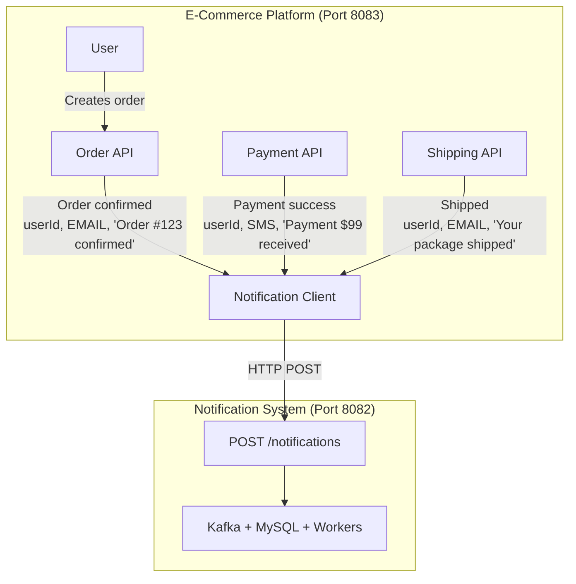

# E-Commerce Platform - Notification System Integration

This is a **demonstration e-commerce platform** that integrates with the **Notification System** as a black box. It shows how any application can send notifications through your notification system without knowing its internal implementation details.

## Architecture Overview



## Key Features

- **Black Box Integration**: E-commerce platform only knows the HTTP API endpoint
- **Asynchronous Notifications**: All order notifications are sent asynchronously for better performance
- **Idempotency**: Prevents duplicate orders with idempotency keys
- **Notification Status Tracking**: Track delivery status of notifications
- **Multiple Channels**: Supports EMAIL, SMS, and WEBHOOK notifications
- **Automatic Notifications**: Triggers notifications on order creation, payment, shipping, and delivery

## Prerequisites

- **Java 17**
- **Maven**
- **MySQL** running on `localhost:3306`
  - Ensure MySQL is installed and running
  - Default credentials: username `root`, password (empty)
- **Notification System** running on `localhost:8082`
  - Start it first: `cd ../Notification-System && docker-compose up -d`
  - Then run: `mvn spring-boot:run` (from notification-service directory)

## Project Structure

```
e-commerce-platform/
├── pom.xml
├── src/main/java/com/ecommerce/platform/
│   ├── EcommercePlatformApplication.java
│   ├── config/
│   │   └── RestTemplateConfig.java
│   ├── client/
│   │   └── NotificationClient.java          ← Black box integration
│   ├── controller/
│   │   ├── OrderController.java
│   │   ├── PaymentController.java
│   │   └── ShipmentController.java
│   ├── domain/
│   │   ├── Order.java                        ← Includes idempotencyKey
│   │   ├── NotificationStatusRecord.java    ← Notification tracking
│   │   ├── Payment.java
│   │   └── Shipment.java
│   ├── dto/
│   │   ├── NotificationChannel.java
│   │   ├── NotificationRequest.java
│   │   ├── NotificationStatusResponse.java  ← Notification status API
│   │   ├── OrderRequest.java                 ← Includes idempotencyKey
│   │   ├── PaymentRequest.java
│   │   └── ShipmentRequest.java
│   ├── model/
│   │   ├── NotificationStatus.java          ← PENDING, SENT, FAILED
│   │   ├── OrderStatus.java
│   │   ├── PaymentStatus.java
│   │   └── ShipmentStatus.java
│   ├── repository/
│   │   ├── NotificationStatusRepository.java
│   │   ├── OrderRepository.java              ← findByIdempotencyKey()
│   │   ├── PaymentRepository.java
│   │   └── ShipmentRepository.java
│   └── service/
│       ├── OrderService.java                 ← Async notification + tracking
│       ├── PaymentService.java
│       └── ShipmentService.java
└── src/main/resources/
    └── application.yml
```

## How to Run

1. **Start the Notification System** (if not already running):
   ```bash
   cd ../Notification-System
   docker-compose up -d
   cd notification-service
   mvn spring-boot:run
   ```

2. **Start the E-Commerce Platform**:
   ```bash
   cd e-commerce-platform
   mvn spring-boot:run
   ```

The platform will start on `http://localhost:8083`

## API Documentation

### Order API

| Endpoint | Method | Description | Notification Sent |
|----------|--------|-------------|-------------------|
| `/api/orders` | POST | Create a new order (async notification) | EMAIL: Order confirmation |
| `/api/orders/{id}/ship` | POST | Mark order as shipped | EMAIL: Shipping notification |
| `/api/orders/{id}/deliver` | POST | Mark order as delivered | SMS: Delivery notification |
| `/api/orders/{id}` | GET | Get order details | None |
| `/api/orders/{id}/notification-status` | GET | Get notification status for order | None |

**Create Order Request:**
```json
{
  "userId": 50,
  "totalAmount": 99.99,
  "idempotencyKey": "unique-key-123"
}
```

**Response:**
```json
{
  "id": 1,
  "userId": 50,
  "orderNumber": "ORD-A1B2C3D4",
  "idempotencyKey": "unique-key-123",
  "totalAmount": 99.99,
  "status": "PENDING",
  "createdAt": "2026-09-14T18:00:00",
  "shippedAt": null,
  "deliveredAt": null
}
```

**Note:** `idempotencyKey` is optional. If provided, duplicate requests with the same key will return the existing order instead of creating a new one.

### Payment API

| Endpoint | Method | Description | Notification Sent |
|----------|--------|-------------|-------------------|
| `/api/payments` | POST | Create a payment | SMS: Payment success |
| `/api/payments/{id}` | GET | Get payment details | None |

**Create Payment Request:**
```json
{
  "userId": 50,
  "orderId": 1,
  "amount": 99.99,
  "paymentMethod": "CREDIT_CARD"
}
```

### Shipment API

| Endpoint | Method | Description | Notification Sent |
|----------|--------|-------------|-------------------|
| `/api/shipments` | POST | Create a shipment | EMAIL: Package prepared |
| `/api/shipments/{id}/ship` | POST | Mark package as shipped | SMS: Package shipped |
| `/api/shipments/{id}/deliver` | POST | Mark package as delivered | EMAIL: Package delivered |
| `/api/shipments/{id}` | GET | Get shipment details | None |

**Create Shipment Request:**
```json
{
  "userId": 50,
  "orderId": 1,
  "shippingAddress": "123 Main St, City, Country"
}
```

## Integration Details

### NotificationClient (Black Box)

The `NotificationClient` class is the only component that knows about the notification system:

```java
@Component
public class NotificationClient {
    
    private final RestTemplate restTemplate;
    private final String notificationServiceUrl;
    
    public void sendNotification(Long userId, NotificationChannel channel, String message) {
        NotificationRequest request = new NotificationRequest();
        request.setUserId(userId);
        request.setChannel(channel);
        request.setMessage(message);
        
        restTemplate.postForObject(notificationServiceUrl, request, Void.class);
    }
}
```

**Key Points:**
- The e-commerce platform doesn't know about Kafka, MySQL, or workers
- It only sends HTTP POST requests to the notification system
- If the notification system is down, it logs an error but doesn't break the e-commerce flow
- The notification system handles all the complexity asynchronously

### Configuration

The notification system URL is configured in `application.yml`:

```yaml
notification:
  service:
    url: http://localhost:8082
    endpoint: /notifications
```

## Example Workflow

1. **User places an order**:
   ```bash
   curl -X POST http://localhost:8083/api/orders \
     -H "Content-Type: application/json" \
     -d '{"userId": 50, "totalAmount": 99.99, "idempotencyKey": "unique-key-123"}'
   ```
   → Order created immediately, notification sent asynchronously: EMAIL "Order #ORD-A1B2C3D4 confirmed!"

2. **Payment is processed**:
   ```bash
   curl -X POST http://localhost:8083/api/payments \
     -H "Content-Type: application/json" \
     -d '{"userId": 50, "orderId": 1, "amount": 99.99, "paymentMethod": "CREDIT_CARD"}'
   ```
   → Notification sent: SMS "Payment of $99.99 received successfully"

3. **Order is shipped**:
   ```bash
   curl -X POST http://localhost:8083/api/orders/1/ship
   ```
   → Notification sent: EMAIL "Your order #ORD-A1B2C3D4 has been shipped!"

4. **Order is delivered**:
   ```bash
   curl -X POST http://localhost:8083/api/orders/1/deliver
   ```
   → Notification sent: SMS "Your order #ORD-A1B2C3D4 has been delivered!"

## Benefits of This Integration

- **Decoupling**: E-commerce and notification systems are completely independent
- **Scalability**: Each system can scale independently
- **Reliability**: Async processing ensures notifications don't block business logic
- **Flexibility**: Easy to add new notification channels without changing e-commerce code
- **Testability**: Can mock NotificationClient for testing

## Async Notifications

The platform uses **asynchronous notification sending** for all order creation requests:

### Performance Benefits

| Endpoint | Response Time | Behavior |
|----------|---------------|----------|
| **Async** (`/api/orders`) | ~17 ms | Returns immediately, notification sent in background |

### Why Async?

- **Order is always saved**: Even if the notification fails, the order is preserved
- **Faster response**: Users get immediate feedback (~17ms vs ~46ms for sync)
- **Better resilience**: Notification System failures don't break order creation
- **Background processing**: Notifications are sent without blocking the user

### How It Works

1. Order is saved to database
2. Notification status is created as `PENDING`
3. Notification is sent asynchronously in background thread
4. Status updates to `SENT` or `FAILED` based on result
5. User gets immediate response with order details

## Production Best Practice: Async-Only Design (1.3)

### Why We Use Only Async

Following production best practices, the platform uses **only asynchronous notification sending** for order creation:

**Reasons:**
1. **Order preservation is critical**: The order must be saved even if notification fails
2. **Better user experience**: Faster response times (~17ms vs ~46ms for sync)
3. **System resilience**: Notification System failures don't break order creation
4. **Simpler architecture**: Single endpoint, predictable behavior

**This ensures that business logic (order creation) is never blocked by auxiliary services (notifications).**

## Idempotency Key (1.1)

### What is Idempotency?

Idempotency ensures that making the same request multiple times produces the same result as making it once. This prevents duplicate orders when users accidentally submit the same request multiple times (e.g., double-clicking a "Submit" button).

### How It Works

1. Client includes a unique `idempotencyKey` in the request
2. Server checks if an order with this key already exists
3. If exists → returns the existing order
4. If not exists → creates a new order and saves the key

### API Usage

**Create Order with Idempotency Key:**
```json
{
  "userId": 100,
  "totalAmount": 99.99,
  "idempotencyKey": "unique-key-123"
}
```

**First Request:**
```json
{
  "id": 1,
  "userId": 100,
  "orderNumber": "ORD-ABC123",
  "idempotencyKey": "unique-key-123",
  "totalAmount": 99.99,
  "status": "PENDING"
}
```

**Second Request (same key):**
```json
{
  "id": 1,
  "userId": 100,
  "orderNumber": "ORD-ABC123",
  "idempotencyKey": "unique-key-123",
  "totalAmount": 99.99,
  "status": "PENDING"
}
```
→ Same order returned, no duplicate created

### Benefits

- **Prevents Duplicate Orders**: Users can't accidentally create multiple orders
- **Safe Retries**: Clients can safely retry failed requests without creating duplicates
- **Better UX**: No need for "Are you sure?" confirmations
- **Database Integrity**: Unique constraint at database level ensures consistency

### Implementation

- `Order.idempotencyKey` column with unique constraint
- `OrderRepository.findByIdempotencyKey()` to check for existing orders
- `OrderService` checks for existing key before creating new order

## Notification Status Tracking (1.2)

### What is Notification Status Tracking?

This feature tracks the status of notifications sent for each order, allowing you to know whether a notification was successfully delivered or failed.

### How It Works

1. When an order is created with async notification, a `notification_status` record is created with status `PENDING`
2. When the notification is successfully sent, status updates to `SENT`
3. If the notification fails, status updates to `FAILED` with error message
4. You can query the notification status for any order

### API Usage

**Get Notification Status:**
```bash
GET /api/orders/{orderId}/notification-status
```

**Response:**
```json
{
  "id": 1,
  "orderId": 1,
  "status": "SENT",
  "errorMessage": null,
  "createdAt": "2026-10-25T16:42:30",
  "updatedAt": "2026-10-25T16:42:30"
}
```

**Status Values:**
- `PENDING`: Notification waiting to be sent
- `SENT`: Notification successfully delivered
- `FAILED`: Notification failed to send (check `errorMessage`)

### Benefits

- **Track Failed Notifications**: Know which orders didn't receive notifications
- **Retry Failed Notifications**: Can retry failed notifications manually or automatically
- **Audit Trail**: Complete history of when notifications were sent
- **Customer Support**: Verify if a customer claims they didn't receive a notification
- **Analytics**: Monitor notification success/failure rates

### Implementation

- `NotificationStatusRecord` entity with orderId, status, errorMessage, timestamps
- `NotificationStatusRepository` to query status by orderId
- `OrderService` creates PENDING record, updates to SENT/FAILED in async callback
- API endpoint `GET /api/orders/{orderId}/notification-status`

## Notification System Architecture

The Notification System uses **Kafka** for asynchronous processing:

```
┌──────────────────────┐      ┌──────────────────────┐      ┌──────────────┐
│  E-Commerce Platform │      │  Notification System │      │     Kafka     │
│                      │      │                      │      │              │
│  POST /notifications │      │  ┌────────────────┐  │      │              │
│  (userId, channel,  │─────>│  │  MySQL         │  │      │              │
│   message)           │      │  │  (PENDING)     │  │      │              │
│                      │      │  └────────────────┘  │      │              │
│                      │      │         │            │      │              │
│                      │      │         │ Publish    │      │              │
│                      │      │         ├────────────>│      │              │
│                      │      │         │            │      │              │
│                      │      │         │            │      │   Topic      │
│                      │      │         │            │      │   (events)   │
│                      │      │         │            │      │              │
│                      │      │         │            │      │              │
│  Response (200 OK)   │      │         │            │      │              │
│  <───────────────────┤      │         │            │      │              │
│                      │      │         │            │      │              │
│                      │      │         │            │      │              │
└──────────────────────┘      │         │            │      │              │
                              │         │            │      │              │
                              │         │            │      │              │
                              │         │            │      │              │
                              │  ┌──────┴──────┐    │      │              │
                              │  │   Workers   │    │      │              │
                              │  └──────┬──────┘    │      │              │
                              │         │            │      │              │
                              │         │ Consume   │      │              │
                              │         │<───────────┤      │              │
                              │         │            │      │              │
                              │         │ Send       │      │              │
                              │         │ Notification│     │              │
                              │         │            │      │              │
                              │         │            │      │              │
                              │         │ Update     │      │              │
                              │         │ (SENT)     │      │              │
                              │         └────────────>│      │              │
                              │                      │      │              │
                              └──────────────────────┘      └──────────────┘
```

### How It Works:

1. **E-commerce sends request** - HTTP POST to `/notifications`
2. **Notification System saves to MySQL** - Status = `PENDING`
3. **Event published to Kafka** - Background workers will process it
4. **Workers consume from Kafka** - Read the event
5. **Send notification** - Email/SMS/etc.
6. **Update MySQL status** - Status = `SENT`

### Why Kafka?

- **Asynchronous** - E-commerce doesn't wait for notification to complete
- **Durable** - Messages are saved in Kafka, won't be lost
- **Scalable** - Multiple workers can process messages in parallel
- **Decoupled** - E-commerce doesn't know about notification details

## Extending the Integration

To add scheduled notifications (e.g., delivery reminders):

```java
// In ShipmentService.java
public Shipment createShipment(Long userId, Long orderId, String shippingAddress) {
    // ... create shipment ...
    
    // Schedule a delivery reminder for 3 days later
    LocalDateTime reminderTime = LocalDateTime.now().plusDays(3);
    notificationClient.sendNotification(
        userId, 
        NotificationChannel.SMS, 
        "Your package will arrive soon!",
        reminderTime
    );
    
    return shipment;
}
```

## Troubleshooting

**Notifications not being sent?**
- Check that Notification System is running on port 8082
- Check logs in both applications
- Verify the notification service URL in `application.yml`

**Database errors?**
- The e-commerce platform uses MySQL for persistent storage
- Ensure MySQL is running on `localhost:3306`
- Database name: `ecommerce` (auto-created if not exists)
- Default credentials: username `root`, password (empty)
- Access MySQL: `mysql -u root -p ecommerce`

## Databases

### 1. E-Commerce Platform
**Database:** MySQL (Persistent Storage)

- **URL:** `jdbc:mysql://localhost:3306/ecommerce`
- **Username:** `root`
- **Password:** (empty)
- **Database Name:** `ecommerce` (auto-created if not exists)
- **Behavior:** `ddl-auto: update` → Schema updated but not dropped

**Access MySQL:**
```bash
# Via command line
mysql -u root -p ecommerce

# Or via MySQL Workbench / DBeaver
Host: localhost
Port: 3306
Database: ecommerce
Username: root
Password: (empty)
```

### 2. Notification System
**Database:** MySQL

- **URL:** `jdbc:mysql://localhost:3306/notifications`
- **Username:** `root`
- **Password:** (empty)
- **Database Name:** `notifications`
- **Behavior:** `ddl-auto: update` → Schema updated but not dropped

**Access MySQL:**
```bash
# Via command line
mysql -u root -p notifications

# Or via MySQL Workbench / DBeaver
Host: localhost
Port: 3306
Database: notifications
Username: root
Password: (empty)
```

### Summary

| Service | Database Type | Location | Persistence |
|---------|--------------|----------|-------------|
| E-Commerce Platform | MySQL | `localhost:3306/ecommerce` | Persistent |
| Notification System | MySQL | `localhost:3306/notifications` | Persistent |

**Note:** Both services now use MySQL for persistent storage. Data is preserved across application restarts.

## Technology Stack

- **Spring Boot 3.3.5**
- **Spring Data JPA**
- **MySQL** (persistent storage)
- **Lombok**
- **RestTemplate** (for HTTP client)
- **Jakarta Validation**
- **Resilience4j** (circuit breaker)
- **Spring Retry** (retry mechanism)


## Circuit Breaker

```text
Client        E-Commerce       Circuit Breaker      Notification
	|                |                  |                  |
	|  POST Order    |                  |                  |
	|--------------->|                  |                  |
	|                |                  |                  |
	|                | Send notification|                  |
	|                |----------------->|                  |
	|                |                  |----------------->|
	|                |                  |       500        |
	|                |                  |<-----------------|
	|                |                  |                  |
	|                |                  | failure count   |
	|                |                  |        ^         |
	|                |                  |                  |
	|                |   ...more failed requests...       |
	|                |                  |                  |
	|                |                  |  threshold hit   |
	|                |                  |                  |
	|                |                  |  OPEN            |
	|                |                  |                  |
	|                | Next request     |                  |
	|                |----------------->|                  |
	|                |                  |                  |
	|                |                  | REJECT           |
	|                |<-----------------|                  |
	|                |                  |                  |
```

```text
                   ADD Order
                       |
                       v
               NotificationClient
                       |
                Circuit Breaker
                 /           \
             CLOSED           OPEN
                |               |
                v               v
              Retry          Fallback
                |               |
                v               v
          Notification       Skip request
```

```text
┌────────┐      ┌─────────────┐      ┌────────────────┐      ┌──────────────┐
│ Client │      │ E-Commerce  │      │ Circuit Breaker│      │ Notification │
│        │      │   Service   │      │ notificationSvc│      │   Service    │
└───┬────┘      └──────┬──────┘      └───────┬────────┘      └──────┬───────┘
	│                  │                     │                      │
	│ POST /orders     │                     │                      │
	│─────────────────>│                     │                      │
	│                  │ sendNotification()  │                      │
	│                  │────────────────────>│                      │
	│                  │                     │                      │
	│                  │                     │ STATE = CLOSED      │
	│                  │                     │                      │
	│                  │                     │────── request ──────>│
	│                  │                     │                      │
	│                  │                     │<────── 200 OK ───────│
	│                  │                     │                      │
	│                  │<────────────────────│                      │
	│<─────────────────│  Order successful  │                      │
	│                  │                     │                      │
	│                  │                     │
	│                  │   ┌─────────────────────────────────────┐
	│                  │   │ FAILURE SCENARIO                    │
	│                  │   │                                     │
	│                  │   │ Notification Service fails          │
	│                  │   │ → Retry attempts occur              │
	│                  │   │ → Circuit records failure           │
	│                  │   └─────────────────────────────────────┘
	│                  │                     │
	│ POST /orders     │                     │
	│─────────────────>│                     │
	│                  │ sendNotification()  │
	│                  │────────────────────>│
	│                  │                     │ STATE = CLOSED      │
	│                  │                     │
	│                  │                     │────── request ──────>│
	│                  │                     │<────── 500 ──────────│
	│                  │                     │                      │
	│                  │                     │ Record failure #1   │
	│                  │                     │                      │
	│                  │                     │
	│ POST /orders     │                     │
	│─────────────────>│                     │
	│                  │ sendNotification()  │
	│                  │────────────────────>│
	│                  │                     │ STATE = CLOSED      │
	│                  │                     │                      │
	│                  │                     │────── request ──────>│
	│                  │                     │<────── 500 ──────────│
	│                  │                     │                      │
	│                  │                     │ Record failure #2   │
	│                  │                     │                      │
	│                  │                     │ Calls = 2            │
	│                  │                     │ Failures = 2         │
	│                  │                     │ Failure Rate = 100%  │
	│                  │                     │                      │
	│                  │                     │ 100% >= 50%          │
	│                  │                     │                      │
	│                  │                     │ STATE: CLOSED        │
	│                  │                     │         ↓            │
	│                  │                     │       OPEN            │
	│                  │                     │                      │
	│                  │                     │
	│ POST /orders     │                     │                      │
	│─────────────────>│                     │                      │
	│                  │ sendNotification()  │                      │
	│                  │────────────────────>│                      │
	│                  │                     │ STATE = OPEN         │
	│                  │                     │                      │
	│                  │                     │ X  Request rejected  │
	│                  │                     │                      │
	│                  │                     │ CallNotPermitted     │
	│                  │                     │ Exception             │
	│                  │                     │                      │
	│                  │<────────────────────│                      │
	│                  │ Circuit fallback    │                      │
	│                  │                     │                      │
	│                  │                     │      WAIT 10s         │
	│                  │                     │──────────────────────│
	│                  │                     │                      │
	│                  │                     │ STATE = HALF_OPEN    │
	│                  │                     │                      │
	│ POST /orders     │                     │                      │
	│─────────────────>│                     │                      │
	│                  │ sendNotification()  │                     │
	│                  │────────────────────>│                     │
	│                  │                     │ HALF_OPEN             │
	│                  │                     │                      │
	│                  │                     │ One trial request    │
	│                  │                     │────── request ──────>│
	│                  │                     │                      │
	│                  │                     │        ┌─────────────┐│
	│                  │                     │<───────│   RESULT    ││
	│                  │                     │        └──────┬──────┘│
	│                  │                     │               │       │
	│                  │                     │       ┌───────┴──────┐│
	│                  │                     │       │              ││
	│                  │                     │    SUCCESS        FAILURE
	│                  │                     │       │              ││
	│                  │                     │       ▼              ▼│
	│                  │                     │    CLOSED           OPEN
	│                  │                     │       │              ││
	│                  │                     │       │          Wait 10s
	│                  │                     │       │              ││
	│                  │                     │       │              └─┐
	│                  │                     │       │                │
	│                  │                     │       │                │
	│                  │<────────────────────│       │                │
	│<─────────────────│       success      │       │                │
	│                  │                     │       │                │
```

```text
				 failure rate >= 50%
		  ┌─────────────────────────┐
		  │                         ▼
	   CLOSED ───────────────────> OPEN
		  ▲                          │
		  │                          │ 10 seconds
		  │                          ▼
		  │                      HALF_OPEN
		  │                       │       │
		  │                    success   failure
		  │                       │       │
		  └───────────────────────┘       └──> OPEN
```
